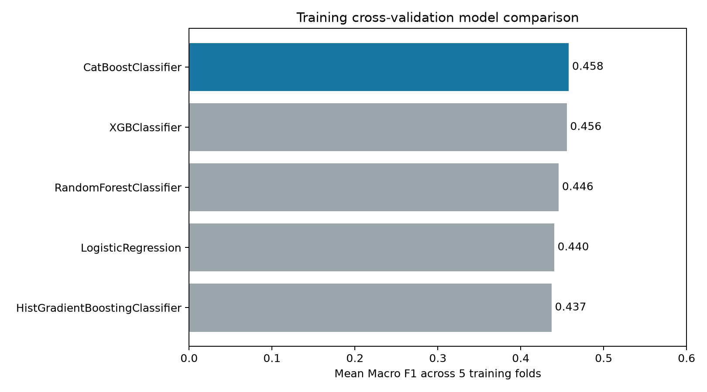
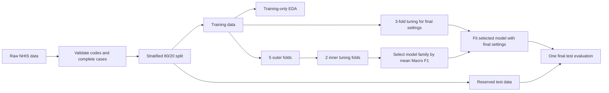
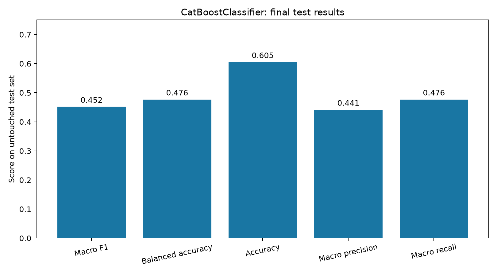
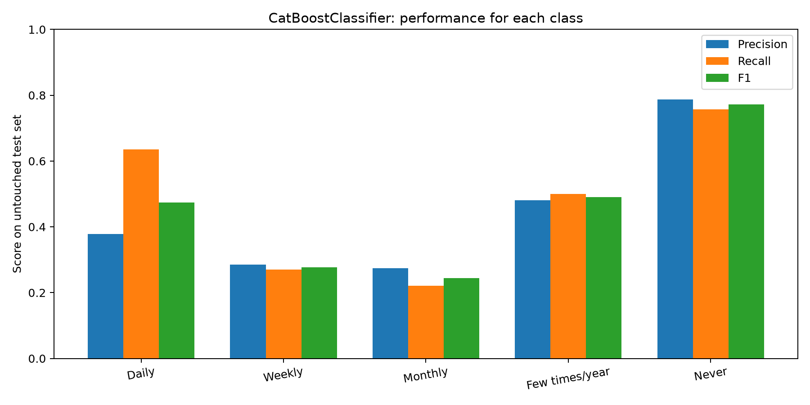
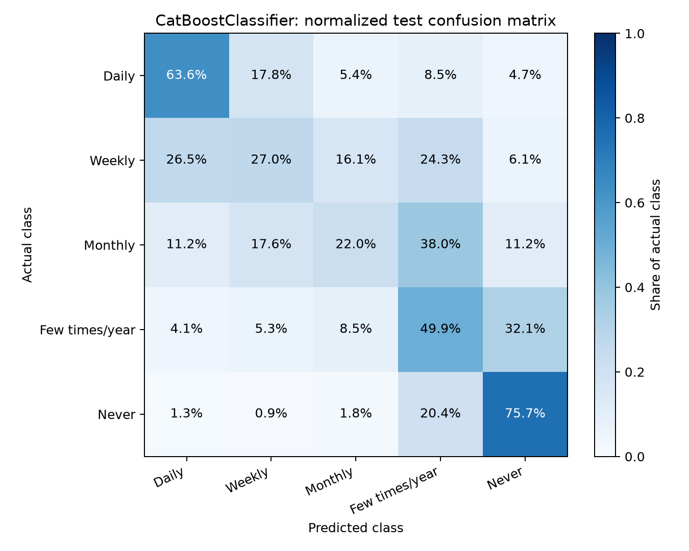

# Predicting Self-Reported Depression Frequency

An end-to-end multiclass classification project using the **2024 National Health Interview Survey (NHIS) Sample Adult file**. Five models predict how often a respondent reports feeling depressed: **Daily, Weekly, Monthly, A few times a year, or Never**.

> This project classifies a survey response measured at the same time as the predictors. It does not diagnose depression, predict a future clinical outcome, or establish that any predictor causes depression.



## Contents

- [Project question](#project-question)
- [Dataset and predictors](#dataset-and-predictors)
- [Method](#method)
- [Models and tuning](#models-and-tuning)
- [Results](#results)
- [Reproduce the analysis](#reproduce-the-analysis)
- [Limitations and responsible use](#limitations-and-responsible-use)
- [Improvements planned](#improvements-planned)

## Project question

**How accurately can demographic, physical-health, and psychosocial survey responses classify a respondent's self-reported depression frequency?**

The project emphasizes performance across all five classes. This matters because 52.8% of the cleaned sample answered **Never**, while only 4.2% answered **Daily**. Accuracy alone can hide poor predictions for uncommon answers, so **Macro F1** is selected before modeling as the primary metric.

## Dataset and predictors

The data come from the CDC's [2024 NHIS Sample Adult public-use file](https://www.cdc.gov/nchs/nhis/documentation/2024-nhis.html). Viewers can [download the original `adult24.csv` archive directly from CDC/NCHS](https://ftp.cdc.gov/pub/health_Statistics/nchs/Datasets/NHIS/2024/adult24csv.zip). The raw file contains 32,629 respondents. Deterministic validity checks and a complete-case rule retain **30,913 respondents**; 1,716 rows (5.26%) are removed. The [official codebook](https://ftp.cdc.gov/pub/Health_Statistics/NCHS/Dataset_Documentation/NHIS/2024/Adult-codebook.pdf) defines every response code.

The 11 predictors were chosen from domain-relevant variables before model comparison. Closely overlapping depression items such as hopelessness and worthlessness were excluded to reduce direct symptom overlap with the target.

| Variable | Domain | Plain-language meaning |
|---|---|---|
| `AGEP_A` | Demographic | Age in years; 85 represents 85 or older |
| `SEX_A` | Demographic | Sex recorded by NHIS |
| `MARITAL_A` | Demographic | Marital or partner status |
| `ANXEV_A` | Psychosocial | Whether the respondent has ever had anxiety |
| `ANXFREQ_A` | Psychosocial | Frequency of anxiety feelings |
| `NERVOUS_A` | Psychosocial | Frequency of feeling nervous |
| `RESTLESS_A` | Psychosocial | Frequency of feeling restless or fidgety |
| `LSATIS4_A` | Psychosocial | Overall life satisfaction |
| `PHSTAT_A` | Physical health | General health status |
| `SLPREST_A` | Physical health | Frequency of waking well rested |
| `SUPPORT_A` | Psychosocial | Frequency of receiving social or emotional support |
| `DEPFREQ_A` | Target | Daily, Weekly, Monthly, A few times/year, or Never |

Raw response codes, special missing codes, and accepted ranges are documented in [`1_cleaning.py`](1_cleaning.py) and the codebook.

## Method



1. Validate NHIS codes and remove rows missing any selected field.
2. Make a reproducible stratified split: **24,730 training rows** and **6,183 test rows**.
3. Perform analytical EDA using the training rows. The missingness chart is a full-source cleaning audit completed before row filtering.
4. Tune each model with three training folds to obtain settings for the eventual full-training fit.
5. Compare model families with **nested stratified cross-validation**: five outer folds estimate performance and two inner folds retune settings independently inside every outer fold.
6. Select the model with the highest mean outer-fold Macro F1, apply its Step 4 settings, fit it on all training rows, and evaluate it on the reserved test set.

Scaling, categorical encoding, and class-weight calculation occur inside each training fold through scikit-learn pipelines. This prevents validation-fold information from entering preprocessing or tuning.

## Models and tuning

| Model | Main settings explored | Selected settings |
|---|---|---|
| Logistic Regression | `C`, class weights | `C=0.1`, balanced weights |
| Random Forest | maximum depth, class weights | depth 12, balanced subsample |
| Histogram Gradient Boosting | leaf nodes, class weights | 31 leaves, balanced weights |
| XGBoost | depth, learning rate, trees, weight strength | depth 2, rate 0.1, 400 trees, square-root weights |
| CatBoost | depth, learning rate, trees, weight strength | depth 3, rate 0.1, 300 trees, square-root weights |

Three-fold training CV in `4_tuning.py` determines the settings used for the final fit. During model comparison, `5_cv_evaluation.py` repeats tuning inside each two-fold inner loop so every outer-fold score remains independent of its validation rows. Both are needed because nested CV provides an honest model-family comparison, while Step 4 provides settings learned from all available training rows for the final fitted model. Square-root weighting gives uncommon classes extra influence, but less aggressively than fully balanced weights.

### Evaluation metrics

- **Macro F1:** averages the five class F1 scores equally; primary selection metric.
- **Balanced accuracy / Macro recall:** average recall across the five classes.
- **Accuracy:** overall proportion classified correctly.
- **Macro precision:** average precision across the five classes.
- **Per-class precision, recall, and F1:** show which answers remain difficult.

ROC AUC is omitted from the main presentation because this project makes a five-class decision and focuses on class-specific precision and recall. Multiclass AUC could be added as a secondary probability-ranking metric.

## Results

### Training-only nested cross-validation

Values are mean ± standard deviation across five outer folds. The standard deviation describes variation among these folds; it is not a confidence interval.

| Model | Macro F1 | Balanced accuracy | Accuracy | Macro precision |
|---|---:|---:|---:|---:|
| **CatBoost** | **0.458 ± 0.008** | 0.477 ± 0.010 | **0.608 ± 0.004** | **0.448 ± 0.006** |
| XGBoost | 0.456 ± 0.011 | 0.478 ± 0.012 | 0.607 ± 0.004 | 0.445 ± 0.011 |
| Random Forest | 0.446 ± 0.005 | 0.486 ± 0.006 | 0.570 ± 0.004 | 0.428 ± 0.005 |
| Logistic Regression | 0.440 ± 0.004 | **0.502 ± 0.007** | 0.560 ± 0.001 | 0.422 ± 0.004 |
| Histogram Gradient Boosting | 0.437 ± 0.004 | 0.495 ± 0.007 | 0.561 ± 0.002 | 0.418 ± 0.003 |

CatBoost and XGBoost are a **near tie**: their mean Macro F1 differs by 0.002. CatBoost is selected because the decision rule was fixed as the highest mean Macro F1, but this small difference is not evidence that it is universally better.

### Final test evaluation

CatBoost is fitted on all 24,730 training rows and evaluated on the 6,183 test rows:

| Metric | CatBoost | Majority-class Dummy | Absolute gain |
|---|---:|---:|---:|
| Macro F1 | **0.452** | 0.138 | **+0.313** |
| Balanced accuracy / Macro recall | **0.476** | 0.200 | **+0.276** |
| Accuracy | **0.605** | 0.528 | **+0.077** |
| Macro precision | **0.441** | 0.106 | **+0.336** |

Absolute gains are reported because relative percentages can exaggerate improvement when the baseline score is small.



### Performance by depression-frequency class

| Class | Precision | Recall | F1 |
|---|---:|---:|---:|
| Daily | 0.378 | 0.636 | 0.474 |
| Weekly | 0.286 | 0.270 | 0.278 |
| Monthly | 0.274 | 0.220 | 0.244 |
| A few times/year | 0.481 | 0.499 | 0.490 |
| Never | 0.788 | 0.757 | 0.772 |





### Interpretation

- The model adds substantial information beyond always predicting **Never**.
- **Never** is the easiest class, while **Weekly** and **Monthly** are hardest.
- Daily recall is relatively high, but its lower precision means some less frequent cases are predicted as Daily.
- Anxiety frequency is CatBoost's most influential predictor. Feature importance measures model usage and does not establish causation.
- Logistic Regression has the highest balanced accuracy, showing the tradeoff between broad class recall and the precision-recall balance summarized by F1.

## Reproduce the analysis

### 1. Get the data

Download the [`adult24.csv` ZIP archive directly from CDC/NCHS](https://ftp.cdc.gov/pub/health_Statistics/nchs/Datasets/NHIS/2024/adult24csv.zip), extract it, and download the [official codebook](https://ftp.cdc.gov/pub/Health_Statistics/NCHS/Dataset_Documentation/NHIS/2024/Adult-codebook.pdf). The complete [2024 NHIS documentation page](https://www.cdc.gov/nchs/nhis/documentation/2024-nhis.html) provides additional survey documentation. Place the extracted files at:

```text
doc/adult24.csv
doc/adult-codebook.pdf
```

The raw CSV is excluded by `.gitignore` because it is a large external source file. The CDC reports 32,629 records for the public-use Sample Adult CSV.

### 2. Create the environment

The recorded environment uses Python 3.14 and pinned package versions:

```bash
python3 -m venv .venv
.venv/bin/python -m pip install --upgrade pip
.venv/bin/python -m pip install -r requirements.txt
```

On macOS, XGBoost may also require `brew install libomp`.

### 3. Run the workflow

Run everything with one command:

```bash
.venv/bin/python run_pipeline.py
```

Or run each step separately:

```bash
.venv/bin/python 1_cleaning.py
.venv/bin/python 2_split.py
.venv/bin/python 3_eda.py
.venv/bin/python 4_tuning.py
.venv/bin/python 5_cv_evaluation.py
.venv/bin/python 6_test_set.py
.venv/bin/python 7_visualizations.py
```

The nested model comparison is the slowest step because it tunes five models inside five outer folds. Expect the full workflow to take tens of minutes on a typical laptop; runtime depends on the processor and library versions. Every script uses random seed 42 where the library supports one.

## Repository structure

```text
.
├── 1_cleaning.py              # Validity checks and complete-case audit
├── 2_split.py                 # Stratified 80/20 split
├── 3_eda.py                   # Training-only exploratory analysis
├── 4_tuning.py                # Final setting selection on training data
├── 5_cv_evaluation.py         # Nested 5 outer × 2 inner CV comparison
├── 6_test_set.py              # One final selected-model test evaluation
├── 7_visualizations.py        # Presentation-ready figures
├── run_pipeline.py            # Runs all seven steps in order
├── project_common.py          # Shared models, pipelines, grids, and constants
├── requirements.txt           # Pinned Python dependencies
├── doc/                       # External data and official codebook
├── output/                    # Tables, trained model, and figures
└── legacy/                    # Earlier experiments; excluded from final workflow
```

## Limitations and responsible use

1. **Concurrent classification:** predictors and target are from the same survey interview. Results do not demonstrate future prediction.
2. **Self-reported outcome:** `DEPFREQ_A` is a survey response rather than a clinical diagnosis.
3. **Conceptual overlap:** anxiety and emotional-wellbeing questions are related to depression and may make classification easier.
4. **Complete-case analysis:** removing 5.26% of respondents may introduce selection bias if missingness is systematic.
5. **Complex survey design:** NHIS sampling weights, strata, and clusters are not used. Scores describe predictive performance in this sample and are not national prevalence estimates.
6. **Model uncertainty:** CatBoost and XGBoost are nearly tied across CV folds. A different sample or split could change their order.
7. **Categorical correlations:** Pearson correlation on survey codes is included only as an exploratory view; code distances are not always meaningful.
8. **Development history:** the test set is reserved from the final scripted workflow, but earlier experiments were inspected during development. For a formal external benchmark, create and lock a new test set before further model or feature changes.

This model should not be used for diagnosis, treatment, eligibility decisions, or decisions about an individual person.

## Improvements planned

- Compare the final predictors with a demographic-only model and the original 14-predictor proposal using training-only nested CV.
- Add Cramér's V or mutual information for categorical exploratory analysis.
- Repeat nested CV or bootstrap test predictions for uncertainty intervals.
- Investigate survey-weighted training and evaluation where model support allows.
- Add a stratified random Dummy baseline alongside the majority-class baseline.
- Add unit tests, a smoke-test dataset, and GitHub Actions continuous integration.
- Choose a repository license and add `LICENSE`, `CITATION.cff`, and contribution guidance before public release.

## Data source

National Center for Health Statistics. *2024 National Health Interview Survey: Sample Adult public-use data and documentation*. CDC/NCHS. [Original `adult24.csv` download](https://ftp.cdc.gov/pub/health_Statistics/nchs/Datasets/NHIS/2024/adult24csv.zip) · [Dataset and documentation page](https://www.cdc.gov/nchs/nhis/documentation/2024-nhis.html).
